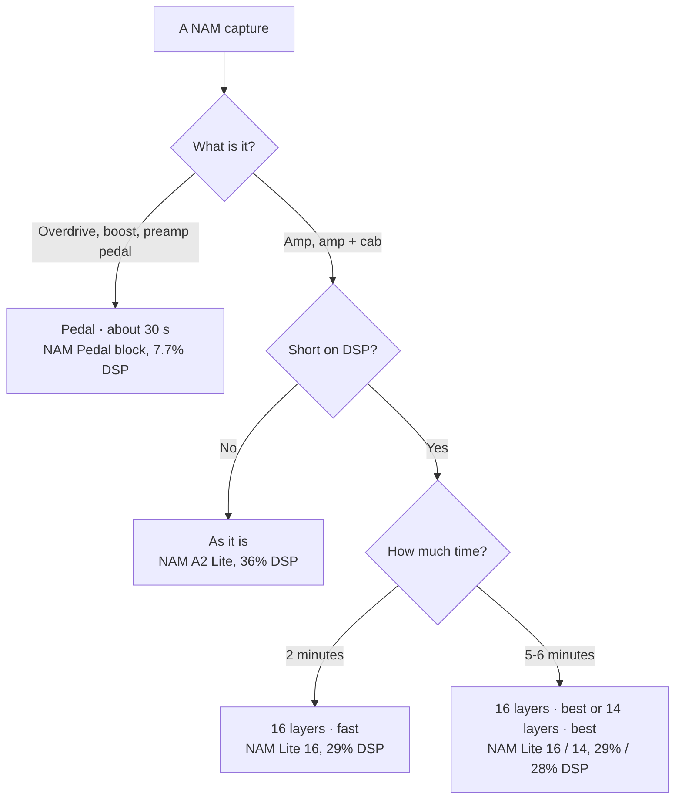
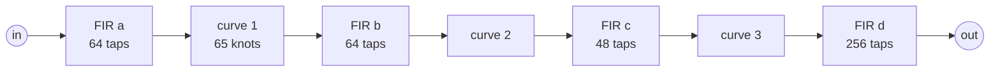
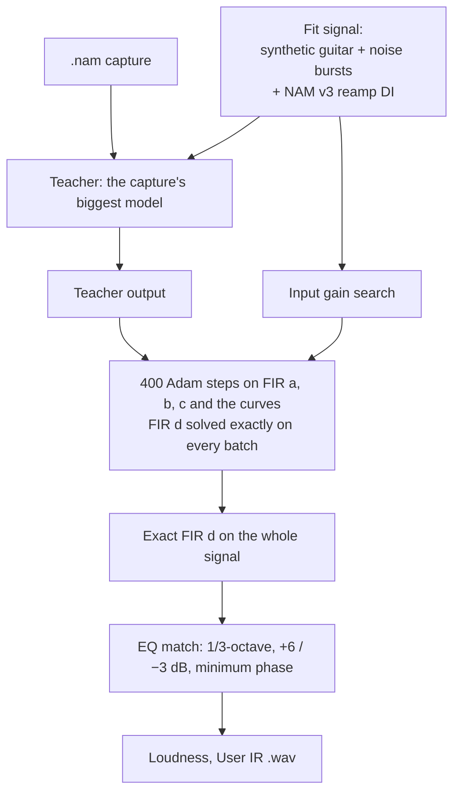
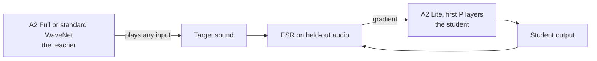

[English](light-nam.md) · [Русский](light-nam.ru.md)

# Lighter NAM on the Helix LT: NAM Pedal and lighter captures

A NAM A2 Lite block takes 36% of a Helix LT DSP. Two of them and there is little room left for the rest of a
rig. This guide explains the two ways this project makes NAM cheaper, how each one works inside, and when to
use which:

- **NAM Pedal**, a fifth block for overdrives and boosts: a small fixed model fitted to a NAM capture in about
  30 seconds. It takes **7.7% of a DSP**, under a quarter of a NAM block.
- **Lighter captures** for the amp blocks: the capture's own network, retrained to use only its first 16 or 14
  layers, for **29% or 28% of a DSP**.

Both run on the `NAM5_PEDAL` firmware (`helix-lt/lt_port.py --pedal`) and are built into
[HX Edit NAM](https://github.com/andreidevs/hx-edit-nam), which asks how to convert a capture when you import it
or pick it on TONE3000.

## The five blocks

| Block | Plays | DSP cost (of 9,000) | Measured on a Helix LT |
| --- | --- | --- | --- |
| NAM A2 Lite | any A2 Lite capture (23 layers) | 3,650 | 36.2% |
| NAM Lite 20 | up to 20 layers | 3,300 | 32.8% |
| NAM Lite 16 | up to 16 layers | 2,950 | 29.2% |
| NAM Lite 14 | up to 14 layers | 2,770 | 27.5% |
| **NAM Pedal** | pedal models from `tools/nam_pedal.py` | **850** | **7.7%** (8.2% for 99% of calls) |

The DSP cost is what HX Edit and the unit count when they decide whether a block still fits. It is set from the
measured load, with a margin, so HX Edit does not grey out blocks that would fit.

A block refuses what it cannot play: a capture with more layers than its limit, or a pedal model in a NAM block
(and a NAM capture in NAM Pedal), plays silence. So a block never goes over its DSP cost.

## Which mode for which capture



| Mode in HX Edit NAM | Time on a laptop CPU | Block | Error against the capture |
| --- | --- | --- | --- |
| As it is | instant | NAM A2 Lite | the capture itself |
| Pedal | about 25-35 s | NAM Pedal | 0.4-1.7% on a Benson preamp; 0.4-6% on 13 TONE3000 pedals |
| 16 layers · fast | about 2 min | NAM Lite 16 | 0.54% (the full Lite: 0.41%) |
| 16 layers · best | about 6 min | NAM Lite 16 | 0.36% |
| 14 layers · best | about 5 min | NAM Lite 14 | 0.60% |

The error is ESR (error-to-signal ratio) against the capture's own biggest model, on audio held out from the
fit: the energy of the difference divided by the energy of the capture's output.

There is no "14 layers · fast": in 800 steps a 14-layer net did not learn the top end and lost 8-11 dB above
6 kHz on the same capture. With more steps it does.

## NAM Pedal

### Why a different model

A NAM capture is a WaveNet: 23 layers of dilated convolutions that can learn almost any sound, an amp's
interaction between stages included. Most drive pedals are far simpler. Electrically, an overdrive is a filter,
a clipping stage, a tone filter and an output stage. A model that copies that shape needs a few hundred numbers
and no neural network:



- A **FIR** is a short linear filter: each output sample is a weighted sum of the last N input samples. It
  shapes the tone: the pedal's input filter, the treble boost before clipping, the tone control.
- A **curve** is the clipping: a fixed transfer curve, 65 points evenly spaced on −4…4 with straight lines
  between them and the end segments continued. Soft clipping, hard clipping and asymmetric clipping are all
  curves.
- Three filter-curve stages cover multi-stage pedals. The last FIR (256 taps, 5 ms) carries the output EQ and
  most of the pedal's frequency response.

That is 627 coefficients in all, against 1,871 weights of an A2 Lite. More importantly, there is no
recurrent state to fetch from external memory: the kernel keeps the four filter histories in the block's own
on-chip memory and needs no DMA at all. Hence 7.7% of a DSP instead of 36%.

What this model cannot do is change its tone with the level beyond what the curves give, or reproduce an amp's
power-stage sag and the interaction between many stages. That is why amp captures lose much more (10-18% on
AC30 captures, against 0.4-6% on pedals): **use NAM Pedal for pedals, a NAM block for amps.**

### How the converter fits it

`tools/nam_pedal.py` turns a `.nam` pedal capture into this model. It never needs the real pedal or any
recording of it: the capture itself is the **teacher**. The converter plays signals through the capture's
biggest model and fits the small model to its output.



1. **The fit signal.** 30 s of synthetic guitar (plucked strings, chords, palm mutes at many levels) and white
   noise bursts, plus the guitar and bass DI of NAM's standard v3 reamp file (`tools/nam_v3_input.wav`, its
   17-180 s). Real playing fits high-gain pedals much better than synthetic notes, for about 10 s more.
2. **Input gain.** The converter tries input gains from 1 to 32 and keeps the one that fits best, so the curves
   see the signal at the level the pedal clips at.
3. **Gradient descent, with one stage solved exactly.** The output, FIR d, is linear in the model's last signal,
   so for any FIR a-c and curves, the best FIR d is a least-squares problem with an exact answer. Each of the
   400 Adam steps (one-cycle learning rate) solves FIR d exactly on its batch and trains only the rest through
   that solve. This trick, *variable projection*, roughly halves the number of unknowns the optimiser has to
   find and makes 400 steps enough. At the end FIR d is solved once more on the whole signal.
4. **The loss listens to the whole spectrum.** Plain ESR is dominated by the loud low mids, so a fit can miss
   the highs and still score well. The loss adds the ESR of a pre-emphasised signal and the mean ESR over nine
   octave bands from 40 Hz to 20 kHz, so lows and highs count as much as the mids.
5. **EQ match.** Small models still tend to roll off the extremes slightly. After the fit, the converter
   compares the model's and the teacher's spectra in 1/3-octave bands, builds a correction limited to +6 / −3 dB,
   turns it into a minimum-phase filter and folds it into FIR d. It costs nothing at play time.
6. **The file.** The coefficients are written as a User IR `.wav` (2,048 samples), like a NAM capture, with a
   header that marks it as a pedal model and the loudness normalised as NAM's Normalized mode does.

On a Benson preamp at three gains the result is 0.4-1.7% ESR with every octave band within 2 dB of the capture.
On 13 popular TONE3000 pedals it is 0.4-6%: the cleanest boosts are near 0.4%, a high-gain fuzz near 6%.

### The block in the firmware

The pedal block is the NAM kernel's fifth model (`helix-lt/lt_pedal.py`, on top of the four-block build). It
takes no NAM slot: its state lives in its own data memory block (the model check, crossfade, tone stack and
knobs are the NAM path's), the coefficients after it, the four filter histories in its program memory block.

Measured on a Helix LT with the meter build: **11,536 cycles a call (median), 7.7% of a DSP; 12,336 (8.2%)
for 99% of calls**; once, when a new model loads, about 18,700 (12.5%). The DSP cost is set to 850 of 9,000.
In the simulator the block matches a float32 reference bit for bit and preserves every register.

## Lighter captures

### Why fewer layers

An A2 Lite is a WaveNet with 23 layers. Each layer looks further back in time (dilation) and adds detail.
Most of the sound is in the first layers; the last ones add less and less. The `--layers` firmware can **skip**
layers: the converter writes how many layers a capture uses into the User IR, and the kernel does not compute
the rest. A capture that uses 16 layers costs 29% of a DSP instead of 36%.

Just deleting layers from an existing capture would change its sound. The capture has to be retrained to work
with 16 layers.

### Distillation: the capture teaches itself



A TONE3000 A2 file holds two sizes of the same capture: the A2 Full (12,146 weights) and the A2 Lite (1,871).
`tools/nam_refine.py --layers P` keeps the Lite's first P layers, sets the others to zero and trains it against
the **Full**. The Full plays any input, so no reamping and no hardware are needed: the fit signal is synthetic
guitar, NAM's loudness signal and, if given, real DI recordings.

- It **starts from the capture's own Lite**, its first P layers, not from scratch, so it only has to learn to
  do without the rest.
- The error is ESR against the teacher on a held-out part. The best weights seen are kept, so a result never
  comes out worse than where it started.
- A zero layer adds exactly 0, so the file is still an ordinary A2 Lite: it plays the same on any build, and
  only the `--layers` firmware saves DSP with it.
- Fast = 800 steps, best = 3,000 steps. A capture without a bigger model inside (an A2 Lite only) has no
  teacher and cannot be made lighter.

On a Benson Preamp G8 capture: the full A2 Lite 0.41%, 16 layers fast 0.54%, 16 layers best 0.36% (better
than the original Lite: training against the Full also fixes some of the Lite's own error), 14 layers best
0.60%.

## In HX Edit NAM

[HX Edit NAM](https://github.com/andreidevs/hx-edit-nam) v0.6.0 does all of this from the editor:

- At start it asks which firmware is installed (one NAM block, `NAM4_LAYERS` or `NAM5_PEDAL`) and shows the
  matching blocks with their real DSP loads.
- **Import** asks how to convert each capture (the table above). Training runs with a progress bar and Cancel;
  results are cached, so the same capture in the same mode converts once.
- **TONE3000** has one tile per NAM block (TONE3000 A2, Lite 16, Lite 14, Pedal). Each tile is a copy of its
  block's row, so HX Edit greys it out exactly when that block would not fit. A converting tile lets you pick
  the profile first, and the pane shows the block and the conversion it loads into.
- Auditions use a free User IR slot and never undo the previous one; **Close** puts the block back as it was,
  **Save to Helix** keeps it.

Training needs Python with torch; the Windows package of HX Edit NAM carries it, so nothing else is needed
there.

## Building the firmware

```sh
python helix-lt/lt_port.py floor-port "path/to/Helix_LT_v3.80.0_0x7d01f5efb.hxf" --pedal
```

The output is `helix-lt/build/Helix_LT_v3.80.0_NAM5_PEDAL.hxf`, expected MD5
`1c83ee3ae2710caeb0105c6cc7175985`. It is for personal use: **never share the file.** The build steps,
installing and recovering are in the [Helix LT guide](../helix-lt/README.md).

Converting a pedal by hand:

```sh
python tools/nam_pedal.py "My Pedal.nam" -o "My Pedal PED.wav" -v
```

Then load the `.wav` into a User IR slot and pick it in a NAM Pedal block.

### Status

- NAM Pedal ran on a Helix LT (the meter build): it plays pedal models, and the DSP numbers above are from it.
- Not yet confirmed: two NAM blocks and a NAM Pedal block on one DSP path.
