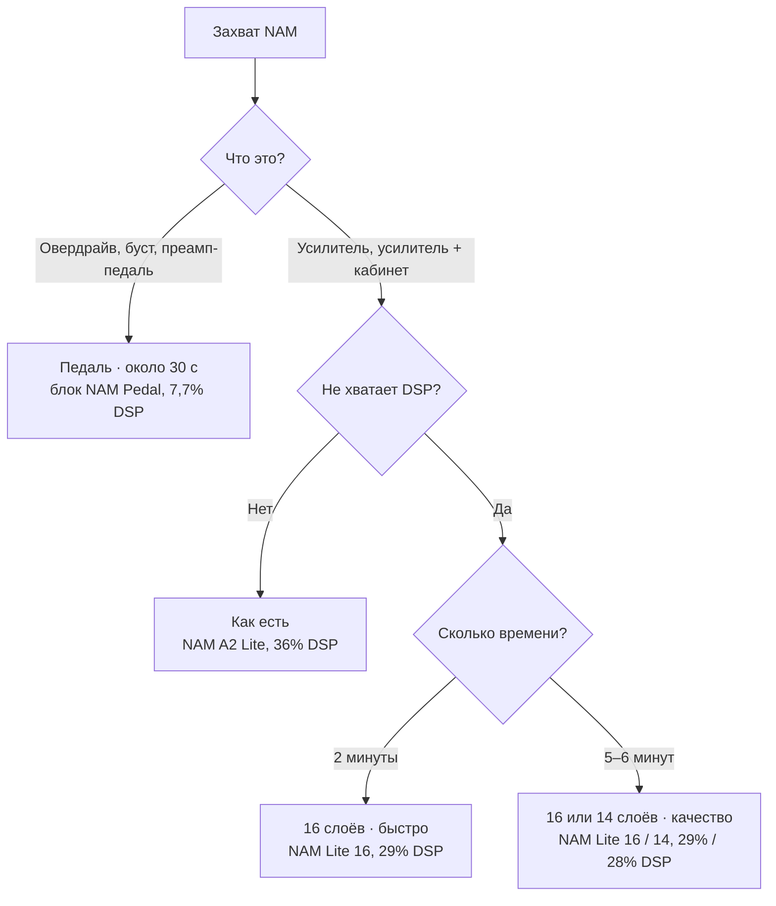
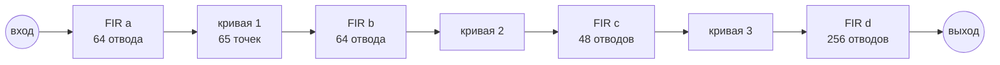
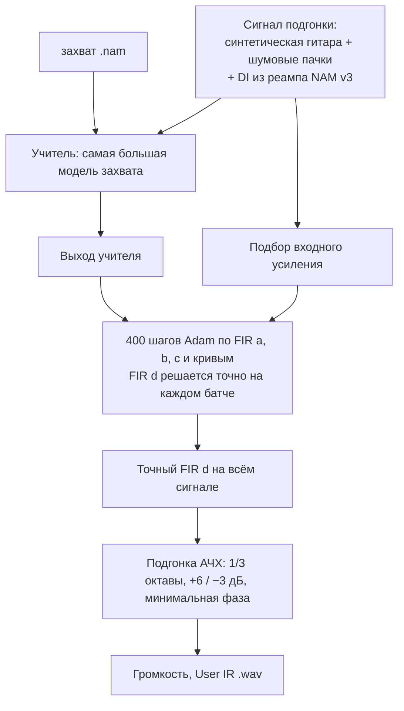
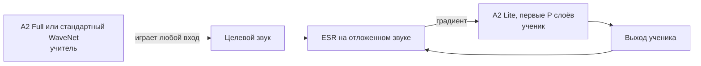

[English](light-nam.md) · [Русский](light-nam.ru.md)

# Облегчённый NAM на Helix LT: NAM Pedal и облегчённые захваты

Блок NAM A2 Lite занимает 36% DSP Helix LT. Два таких блока, и на остальную цепочку почти не остаётся места.
Здесь описаны два способа, которыми этот проект делает NAM дешевле: как каждый устроен внутри и когда какой
выбирать.

- **NAM Pedal**, пятый блок для овердрайвов и бустов: маленькая модель фиксированной формы, которую подгоняют
  под захват NAM примерно за 30 секунд. Занимает **7,7% DSP**, меньше четверти блока NAM.
- **Облегчённые захваты** для блоков усилителей: собственная сеть захвата, дообученная работать только на
  первых 16 или 14 слоях, за **29% или 28% DSP**.

Оба способа работают на прошивке `NAM5_PEDAL` (`helix-lt/lt_port.py --pedal`) и встроены в
[HX Edit NAM](https://github.com/andreidevs/hx-edit-nam): он спрашивает, как конвертировать захват, при импорте
и при выборе в TONE3000.

## Пять блоков

| Блок | Что играет | Стоимость DSP (из 9 000) | Замер на Helix LT |
| --- | --- | --- | --- |
| NAM A2 Lite | любой захват A2 Lite (23 слоя) | 3 650 | 36,2% |
| NAM Lite 20 | до 20 слоёв | 3 300 | 32,8% |
| NAM Lite 16 | до 16 слоёв | 2 950 | 29,2% |
| NAM Lite 14 | до 14 слоёв | 2 770 | 27,5% |
| **NAM Pedal** | модели педалей из `tools/nam_pedal.py` | **850** | **7,7%** (8,2% для 99% вызовов) |

Стоимость DSP — это то, что считают HX Edit и сам прибор, когда решают, поместится ли блок. Она выставлена по
замеру с запасом, поэтому HX Edit не блокирует блоки, которые на самом деле помещаются.

Блок отказывается играть то, что ему не по силам: захват с большим числом слоёв, чем его предел, или модель
педали в блоке NAM (и захват NAM в NAM Pedal) играют тишину. Поэтому блок никогда не превышает свою стоимость
DSP.

## Какой режим для какого захвата



| Режим в HX Edit NAM | Время на процессоре ноутбука | Блок | Ошибка относительно захвата |
| --- | --- | --- | --- |
| Как есть | сразу | NAM A2 Lite | сам захват |
| Педаль | около 25–35 с | NAM Pedal | 0,4–1,7% на преампе Benson; 0,4–6% на 13 педалях TONE3000 |
| 16 слоёв · быстро | около 2 мин | NAM Lite 16 | 0,54% (полный Lite: 0,41%) |
| 16 слоёв · качество | около 6 мин | NAM Lite 16 | 0,36% |
| 14 слоёв · качество | около 5 мин | NAM Lite 14 | 0,60% |

Ошибка — это ESR (отношение энергии ошибки к энергии сигнала) относительно самой большой модели захвата, на
звуке, который не участвовал в подгонке.

Режима «14 слоёв · быстро» нет: за 800 шагов 14-слойная сеть не успевала выучить верха и теряла 8–11 дБ выше
6 кГц на том же захвате. С большим числом шагов она их выучивает.

## NAM Pedal

### Почему другая модель

Захват NAM — это WaveNet: 23 слоя растянутых свёрток, которые выучивают почти любой звук, включая
взаимодействие каскадов усилителя. Большинство педалей перегруза устроены гораздо проще. Электрически
овердрайв — это фильтр, каскад ограничения, тембровый фильтр и выходной каскад. Модели такой формы хватает
нескольких сотен чисел и не нужна нейросеть:



- **FIR** — короткий линейный фильтр: каждый отсчёт выхода — взвешенная сумма последних N отсчётов входа. Он
  задаёт тембр: входной фильтр педали, подъём верхов перед ограничением, регулятор Tone.
- **Кривая** — это ограничение (клиппинг): фиксированная передаточная кривая, 65 точек равномерно на −4…4,
  между ними прямые, крайние отрезки продолжены. Мягкое, жёсткое и несимметричное ограничение — всё это кривые.
- Три каскада «фильтр — кривая» покрывают многокаскадные педали. Последний FIR (256 отводов, 5 мс) несёт
  выходной эквалайзер и большую часть частотной характеристики педали.

Всего 627 коэффициентов против 1 871 веса у A2 Lite. Главное же — нет состояния, которое надо подтягивать из
внешней памяти: ядро хранит четыре истории фильтров во внутренней памяти самого блока и вообще не использует
DMA. Отсюда 7,7% DSP вместо 36%.

Чего эта модель не умеет: менять тембр с уровнем сильнее, чем это дают кривые, воспроизводить проседание
оконечного каскада и взаимодействие многих каскадов усилителя. Поэтому захваты усилителей теряют гораздо
больше (10–18% на захватах AC30 против 0,4–6% на педалях): **NAM Pedal — для педалей, блок NAM — для
усилителей.**

### Как конвертер её подгоняет

`tools/nam_pedal.py` превращает захват педали `.nam` в такую модель. Ему не нужны ни сама педаль, ни её
записи: **учитель** — сам захват. Конвертер прогоняет сигналы через самую большую модель захвата и подгоняет
маленькую модель под её выход.



1. **Сигнал подгонки.** 30 с синтетической гитары (щипки, аккорды, глушение ладонью на разных уровнях) и пачки
   белого шума, плюс гитарный и басовый DI из стандартного файла реампа NAM v3 (`tools/nam_v3_input.wav`, его
   17–180 с). Живая игра подгоняет педали с большим гейном гораздо лучше синтетических нот, ценой примерно 10 с.
2. **Входное усиление.** Конвертер пробует усиление от 1 до 32 и оставляет лучшее, чтобы кривые видели сигнал
   на том уровне, где педаль ограничивает.
3. **Градиентный спуск, где одна ступень решается точно.** Выходной FIR d линеен по последнему сигналу модели,
   поэтому при любых FIR a–c и кривых лучший FIR d — задача наименьших квадратов с точным решением. На каждом
   из 400 шагов Adam (скорость обучения по схеме one-cycle) FIR d решается точно на батче, а остальное
   обучается сквозь это решение. Этот приём, *variable projection*, примерно вдвое уменьшает число неизвестных
   для оптимизатора, и 400 шагов хватает. В конце FIR d ещё раз решается на всём сигнале.
4. **Функция потерь слушает весь спектр.** Обычный ESR определяют громкие низкие середины, и подгонка может
   промахнуться по верхам и всё равно получить хорошую оценку. Поэтому к ESR добавлены ESR сигнала с
   предыскажением и средний ESR по девяти октавам от 40 Гц до 20 кГц: низы и верха весят столько же, сколько
   середина.
5. **Подгонка АЧХ.** Маленькие модели всё равно слегка заваливают края диапазона. После подгонки конвертер
   сравнивает спектры модели и учителя по третям октавы, строит поправку в пределах +6 / −3 дБ, превращает её
   в фильтр с минимальной фазой и вносит в FIR d. При игре это ничего не стоит.
6. **Файл.** Коэффициенты записываются как User IR `.wav` (2 048 отсчётов), как захват NAM, с заголовком,
   который помечает его как модель педали, и с громкостью, выровненной как в режиме Normalized у NAM.

На преампе Benson при трёх положениях гейна результат — 0,4–1,7% ESR, и каждая октава в пределах 2 дБ от
захвата. На 13 популярных педалях TONE3000 — 0,4–6%: самые чистые бусты около 0,4%, фузз с большим гейном
около 6%.

### Блок в прошивке

Блок педали — пятая модель ядра NAM (`helix-lt/lt_pedal.py`, поверх сборки с четырьмя блоками). Он не занимает
слот NAM: его состояние лежит в собственном блоке памяти данных (проверка модели, кроссфейд, темброблок и ручки
— как у тракта NAM), коэффициенты сразу за ним, четыре истории фильтров — в его блоке памяти программ.

Замер на Helix LT со сборкой-измерителем: **11 536 тактов на вызов (медиана), 7,7% DSP; 12 336 (8,2%) для 99%
вызовов**; один раз, при загрузке новой модели, около 18 700 (12,5%). Стоимость DSP выставлена 850 из 9 000. В
симуляторе блок совпадает с эталоном во float32 бит в бит и сохраняет все регистры.

## Облегчённые захваты

### Зачем меньше слоёв

A2 Lite — это WaveNet из 23 слоёв. Каждый следующий слой смотрит дальше в прошлое (dilation) и добавляет
деталей. Основной звук — в первых слоях, последние добавляют всё меньше. Прошивка `--layers` умеет
**пропускать** слои: конвертер записывает в User IR, сколько слоёв использует захват, и ядро не считает
остальные. Захват на 16 слоях стоит 29% DSP вместо 36%.

Если просто удалить слои у готового захвата, его звук изменится. Захват нужно дообучить работать на 16 слоях.

### Дистилляция: захват учит сам себя



Файл A2 с TONE3000 содержит две версии одного захвата: A2 Full (12 146 весов) и A2 Lite (1 871).
`tools/nam_refine.py --layers P` оставляет первые P слоёв Lite, обнуляет остальные и обучает его по **Full**.
Full играет на любом входе, поэтому не нужны ни реамп, ни железо: сигнал подгонки — синтетическая гитара,
сигнал громкости NAM и, если заданы, настоящие записи DI.

- Обучение **начинается с собственного Lite захвата**, с его первых P слоёв, а не с нуля: сети нужно только
  научиться обходиться без остальных.
- Ошибка — ESR относительно учителя на отложенной части. Сохраняются лучшие веса за всё обучение, поэтому
  результат никогда не хуже исходного.
- Нулевой слой добавляет ровно 0, поэтому файл остаётся обычным A2 Lite: он одинаково играет на любой сборке, а
  экономию DSP даёт только прошивка `--layers`.
- Быстро — 800 шагов, качество — 3 000 шагов. Захват без большой модели внутри (только A2 Lite) не имеет
  учителя, и облегчить его нельзя.

На захвате Benson Preamp G8: полный A2 Lite 0,41%, 16 слоёв быстро 0,54%, 16 слоёв качество 0,36% (лучше
исходного Lite: обучение по Full заодно исправляет часть его собственной ошибки), 14 слоёв качество 0,60%.

## В HX Edit NAM

[HX Edit NAM](https://github.com/andreidevs/hx-edit-nam) v0.6.0 делает всё это прямо из редактора:

- При запуске спрашивает, какая прошивка установлена (один блок NAM, `NAM4_LAYERS` или `NAM5_PEDAL`), и
  показывает её блоки с реальной загрузкой DSP.
- **Импорт** спрашивает, как конвертировать каждый захват (таблица выше). Обучение идёт с полосой прогресса и
  кнопкой Cancel; результаты кэшируются, поэтому один и тот же захват в одном режиме конвертируется один раз.
- В **TONE3000** по плитке на каждый блок NAM (TONE3000 A2, Lite 16, Lite 14, Pedal). Каждая плитка — копия
  строки своего блока, поэтому HX Edit делает её серой ровно тогда, когда этот блок не поместится. Плитка с
  конвертацией сначала даёт выбрать профиль, а панель показывает, в какой блок и с какой конвертацией он
  загрузится.
- Пробы занимают свободный слот User IR и не откатывают предыдущую; **Close** возвращает блок как был,
  **Save to Helix** оставляет его.

Для обучения нужен Python с torch; Windows-сборка HX Edit NAM несёт его с собой, больше ничего ставить не нужно.

## Сборка прошивки

```sh
python helix-lt/lt_port.py floor-port "path/to/Helix_LT_v3.80.0_0x7d01f5efb.hxf" --pedal
```

Результат — `helix-lt/build/Helix_LT_v3.80.0_NAM5_PEDAL.hxf`, ожидаемый MD5
`1c83ee3ae2710caeb0105c6cc7175985`. Он только для личного использования: **никогда не распространяйте файл.**
Сборка, установка и восстановление описаны в [руководстве по Helix LT](../helix-lt/README.md).

Конвертация педали вручную:

```sh
python tools/nam_pedal.py "My Pedal.nam" -o "My Pedal PED.wav" -v
```

Затем загрузите `.wav` в слот User IR и выберите его в блоке NAM Pedal.

### Статус

- NAM Pedal работал на Helix LT (сборка-измеритель): играет модели педалей, цифры DSP выше — с него.
- Пока не подтверждено: два блока NAM и блок NAM Pedal на одном тракте DSP.
